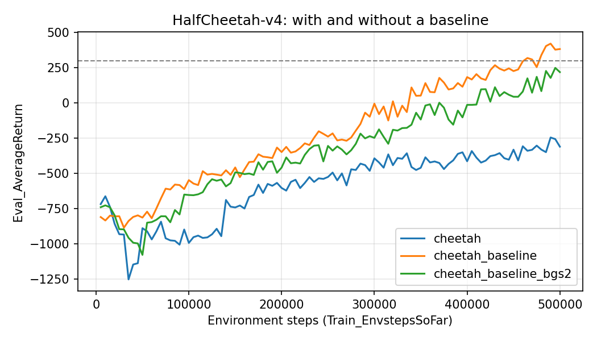
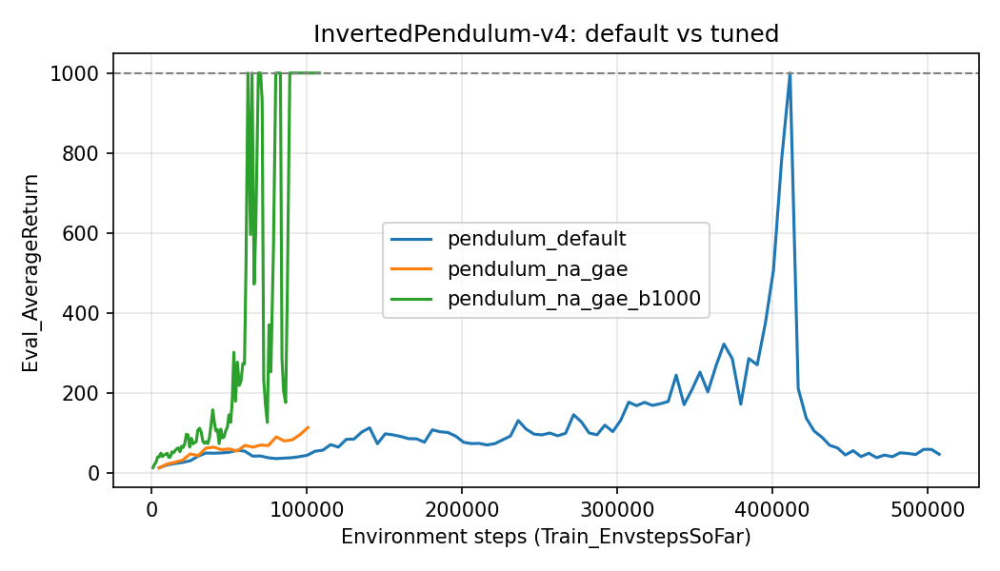
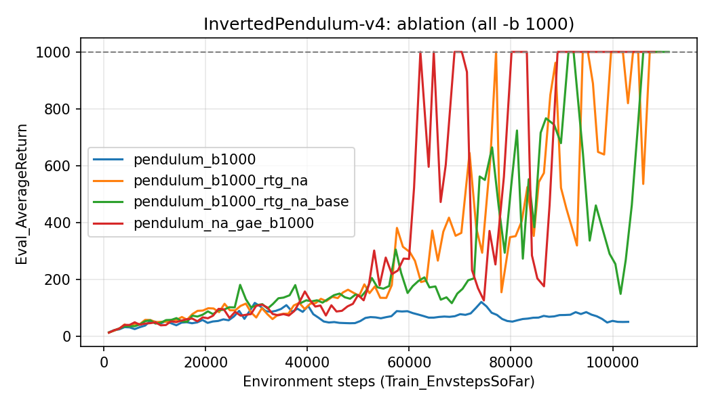

# 심층 강화학습 공부 기록: UC Berkeley CS 285 과제 (독학)

[English](README.md) | **한국어**

UC Berkeley의 **CS 285: Deep Reinforcement Learning, Decision Making, and Control (2026년 봄)** 과제를
직접 풀면서 심층 강화학습을 독학하고 있습니다. 이 저장소는 그 과정을 진행되는 대로 기록합니다.
아직 완전히 이해하지 못한 부분도 함께 적습니다.

> **출처.** 시작 코드, 과제 구성, 환경은
> [berkeleydeeprlcourse/homework_spring2026](https://github.com/berkeleydeeprlcourse/homework_spring2026)에서
> 가져왔으며, MIT 라이선스로 공개되어 있습니다 (Copyright (c) 2026 berkeleydeeprlcourse, [LICENSE](LICENSE) 참고).
> 저는 이 수업의 수강생이 아니며 UC Berkeley와 관련이 없습니다. 제가 바꾼 부분은
> [아래](#내가-바꾼-부분)에 정리했습니다.

## 왜 하는가

**로봇 학습, 특히 VLA(vision-language-action) 모델과 강화학습**을 연구하는 대학원 연구실에 지원하려고
준비하고 있습니다. 컴퓨터공학을 전공했고, 딥러닝·컴퓨터비전 부트캠프를 수료했으며, 지금은 로봇
매니퓰레이션 프로젝트에서 인턴으로 일하고 있습니다. 강화학습은 처음이라, 실제 코딩 과제가 있는 잘 알려진
강의를 골라 과제를 제대로 끝내 보기로 했습니다.

## 지금 어디쯤인지 솔직하게

- **아직 이해하는 중입니다.** MLP, Adam, 학습 루프 같은 딥러닝 기초는 부트캠프에서 배웠습니다. 하지만 이
  코드는 제가 배운 "노트북 한 장" 스타일과 구성이 다릅니다. 손실이 정책 안(`compute_loss`)에 있고, 설정은
  데이터클래스와 터미널 옵션으로 받으며, 평가는 시뮬레이터를 직접 돌립니다. 모든 부분을 이해하는 데 시간이
  걸리고 있습니다.
- **이렇게 채워 가고 있습니다.** 작업하는 파일마다 한 줄씩 한글 주석을 달고 있습니다. 함수마다 무엇을 받아서,
  무엇을 하고, 무엇을 돌려주는지 적습니다. 수식도 작은 숫자 예시로 다시 풀어 봅니다. 지금 다 안다고 말하기보다,
  **과제를 하나씩 할수록 더 깊이 이해하는 것**이 목표입니다.
- **LLM(Claude)을 적극적인 튜터로 쓰고 있습니다.** 개념 설명, 제 설명이 맞는지 확인, 디버깅에 활용합니다.
  누가 무엇을 썼는지 투명하게 밝힙니다.

| HW1 부분 | 어떻게 만들었나 |
|---|---|
| `MSEPolicy` | LLM이 구현과 한 줄씩 설명을 제공했고, 제가 공부해서 각 줄을 설명할 수 있습니다 |
| 학습 루프 (`train.py`) | 빈칸이 있는 뼈대를 제가 채웠고, 제 버그(`==` 오타, 잘못된 함수 이름)를 직접 고쳤습니다 |
| `FlowMatchingPolicy` | LLM이 빈칸 5개짜리 뼈대를 주었고, VS Code 자동완성이 빈칸을 채웠습니다. 이후 빈칸마다 수식과 맞는지 확인했습니다 |
| 한 줄씩 단 한글 주석 | LLM과 함께 공부 노트로 작성했고, 읽어 보며 참고 자료로 남겼습니다 |
| 학습 실행, 그래프, 영상 비교 | 제 노트북 GPU로 돌렸고, 영상 비교는 제가 직접 영상을 보고 관찰한 내용입니다 |

## LLM과 함께 만든 공부 교재

CS 285 강의는 영어인 데다 수식이 빠르게 전개되어, 강화학습을 처음 배우는 제게는 너무 어려웠습니다. 그래서
LLM(Claude)을 이용해 2~8강 내용을 한국어로 다시 풀어 쓴 **동행 교재**를 만들고, 이 교재로 공부하며 과제를 풀고
있습니다: [**study-guide/cs285-study-guide-ko.pdf**](study-guide/cs285-study-guide-ko.pdf) (60쪽)

- **내용:** 모방학습, 오류 누적(O(εT²)), DAgger, MDP, 정책 경사, 액터-크리틱, Q러닝. 한 쪽에 개념 하나씩,
  직관 → 수식 → 숫자 예시 → 퀴즈 순서로 구성했습니다.
- **출처:** Sergey Levine 교수의 CS 285 공개 강의 슬라이드(2026년판)와 강의 영상을 바탕으로 했습니다. 슬라이드를
  번역하거나 복사한 것이 아니라 새로 쓴 해설입니다.
- **주의:** LLM과 함께 썼고 공부하면서 계속 검토하고 있어서, 틀린 부분이 있을 수 있습니다. 정확한 내용은 원래 강의
  자료를 기준으로 삼아 주세요.

### 과제별 수식 정리 노트

과제를 하면서 과제 PDF의 수식을 하나씩 풀어 쓴 노트도 올립니다. LLM(Claude 등)에게 질문하며 정리했고, 제가 읽고
다듬은 공부 기록입니다.

| 파일 | 내용 |
|---|---|
| [hw1/hw1_수식정리.md](hw1/hw1_수식정리.md) | HW1 식 1~3: MSE 손실, Flow Matching 손실, 오일러 적분 |
| [hw2/hw2_수식정리.md](hw2/hw2_수식정리.md) | HW2 식 1~26: 정책 경사 유도, reward-to-go, 기준선, GAE, 정규화 |
| [hw2/src/agents/용어정리.md](hw2/src/agents/용어정리.md) | 6·7장 비유와 HW2 코드 흐름 정리 |
| [study-guide/HW1-HW2_수식정리.pdf](study-guide/HW1-HW2_수식정리.pdf) | 위 두 수식 노트를 합친 PDF (15쪽). 원본 노트는 그대로 두고, LLM이 숫자 예시·코드 연결·빠진 식 (19), (20)을 파란 "보충" 상자로 덧붙임 |

위 교재와 마찬가지로 틀린 부분이 있을 수 있습니다.

## 진행 상황

| 과제 | 주제 | 상태 |
|---|---|---|
| [HW1](hw1/) | 모방학습: MSE와 flow matching으로 액션 청킹 (Push-T) | ✅ 완료 (2026-11-10) |
| [HW2](hw2/) | 정책 경사: reward-to-go, 기준선, GAE | ✅ 완료 (2026-11-17) |
| HW3 | Q러닝과 액터-크리틱: DQN, Double DQN, SAC | ⏳ 예정 |

## HW1: Push-T 모방학습

**과제.** T자 블록을 밀어서 목표 영역에 맞추는 과제입니다. 상태는 5개(로봇 x, y와 블록 x, y, 각도),
행동은 2개(목표 위치)입니다. 두 정책 모두 행동 8개를 한 번에 예측하고, 그 8개를 다시 관측하지 않고 그대로 실행합니다.

### 결과

| 정책 | 목표 | 최종 평가 점수 | 최고 평가 점수 |
|---|---|---|---|
| MSE | 0.5 이상 | **0.548** | 0.636 (7만 스텝) |
| Flow matching | 0.7 이상 | **0.779** | 0.821 (7만 스텝) |

평가 점수는 100판 각각에서 받은 최고 점수의 평균입니다.


W&B에 기록된 값으로 [`hw1/plot_curves.py`](hw1/plot_curves.py)를 써서 그렸습니다. 두 손실 곡선은 값을
서로 비교할 수 없습니다. MSE 정책은 행동을 맞히고 flow 정책은 노이즈가 섞인 속도를 맞히기 때문에, flow 쪽
손실은 원래 더 높게 유지됩니다.

### 구조

두 정책은 같은 MLP 뼈대를 씁니다. 은닉층 3개(각 256)에 ReLU 활성화를 쓰고, 출력 16개를 8 × 2 행동 묶음으로
바꿉니다.

- **MSE 정책:** 상태 5개를 바로 행동 묶음으로 바꿉니다 (파라미터 137,232개).
- **Flow matching 정책:** 상태, 지금의 노이즈 섞인 묶음(16개), flow 진행도 τ를 합쳐 22개를 입력으로 받습니다.
  출력은 묶음과 같은 모양의 속도입니다 (파라미터 141,584개). 실행할 때는 가우시안 노이즈에서 출발해
  오일러 적분 10걸음으로 행동을 만듭니다.
- **학습:** Adam(학습률 3e-4, weight decay 없음), 배치 128, 청크 8, 400 에폭(약 7.56만 스텝), 시드 42.

### 영상에서 보인 것

T의 어느 쪽으로 돌아갈지 정하는 갈림길에서 MSE 정책은 자주 머뭇거리거나 가운데 경로로 흐르고, flow matching
정책은 한쪽을 골라 확실히 갑니다. 움직임도 flow 정책이 더 부드럽고, 마지막 정렬 단계에서 T를 더 정확히
맞춥니다 (예: 에피소드 4). 이는 MSE 회귀가 여러 갈래의 전문가 행동을 평균 내고, flow matching은 그중 하나의
일관된 행동을 뽑는다는 예상과 맞습니다.

### 배운 것

- **MSE가 막히는 이유.** 전문가가 어떨 때는 왼쪽(−1), 어떨 때는 오른쪽(+1)으로 가면, MSE를 최소로 만드는
  행동은 그 평균(0)이고 이건 어느 쪽도 아닙니다. 실제로 MSE 정책은 학습 손실이 계속 줄어드는데도 점수가
  0.55~0.64에서 멈췄습니다.
- **Flow matching이 다른 점.** 무작위 노이즈를 실제 행동으로 옮기는 속도장을 배웁니다. 그래서 노이즈가 다르면
  평균이 아니라 서로 다른 갈래(정답) 중 하나에 도착합니다. π0 같은 VLA 모델도 행동을 만드는 부분에 같은
  아이디어를 씁니다.
- **오류 누적과의 연결.** 행동 복제의 오류는 O(εT²)로 커질 수 있습니다. 정책이 자기 실수 때문에 시연에 없던
  상태로 가기 때문입니다. 액션 청킹은 결정 횟수를 줄여 주므로 이 문제를 줄이는 데 도움이 됩니다.

### 다시 실행하기

```bash
cd hw1
uv run src/hw1_imitation/train.py --policy-type mse --exp-name mse
uv run src/hw1_imitation/train.py --policy-type flow --exp-name flow
uv run --with matplotlib python plot_curves.py
```

`uv`와 W&B 설치 방법은 원래 강의 저장소에 있던 [hw1/README.md](hw1/README.md)를 참고하세요.

## HW2: 정책 경사

지금까지 구현한 것: 환경에서 한 판 돌리기(`utils.py`), 정책의 행동 뽑기와 정책 경사 손실(`policies.py`), 할인 리턴과
reward-to-go, 어드밴티지 정규화(`pg_agent.py`), 학습 루프(`run.py`), 신경망 크리틱(`critics.py`), GAE(`pg_agent.py`). 실험 4개를 모두 마쳤습니다.

HW2 코드를 쓴 방식: TODO마다 LLM이 먼저 비슷한 예시를 주고(막히면 빈칸 뼈대까지), 제가 직접 줄을 쓴 뒤 LLM이
검토했습니다. 검토에서 잡힌 제 실수는 함수 이름을 잘못 부른 것, `np.concatenate` 대신 `np.from_numpy`를 쓴 것,
`rewards`와 `terminals`의 순서를 바꿔 넘긴 것 등이었습니다.

### 실험 1: CartPole (8개, 각 100번 반복, 시드 1)

| 실험 | 배치 | 최종 평가 점수 | 처음 200에 도달한 환경 스텝 |
|---|---|---|---|
| `cartpole` | 1000 | 97.4 | 도달 못 함 |
| `cartpole_rtg` | 1000 | 112.5 | 24,481 |
| `cartpole_na` | 1000 | **200** | 16,409 |
| `cartpole_rtg_na` | 1000 | **200** | **12,595** |
| `cartpole_lb` | 4000 | 181.3 | 88,881 |
| `cartpole_lb_rtg` | 4000 | **200** | 60,630 |
| `cartpole_lb_na` | 4000 | **200** | 64,525 |
| `cartpole_lb_rtg_na` | 4000 | 150.7 | 44,444 |


실행 전에 예측을 먼저 적었습니다. 세 개 중 두 개가 틀렸고, 그 두 개에서 가장 많이 배웠습니다.

| 질문 | 내 예측 | 결과 |
|---|---|---|
| 전체 리턴 vs reward-to-go | 전체 리턴이 나음 | ❌ reward-to-go가 나음. 막대를 쓰러뜨린 행동을 덜 칭찬해서 흔들림(분산)이 줄어듦 |
| 어드밴티지 정규화 | 도움이 됨 | ✅ 가장 큰 효과. CartPole은 보상이 항상 +1이라 평균을 빼는 것이 기준선 역할을 함 |
| 큰 배치(4000) vs 작은 배치(1000), 환경 스텝 기준 | 큰 배치가 빠름 | ❌ 작은 배치가 더 적은 스텝으로 200에 도달. 같은 데이터로 4배 자주 업데이트하기 때문 |

한계: 설정마다 시드 하나라서, 일부 하락(예: `cartpole_lb_rtg_na`의 마지막 부분)은 운일 수 있습니다.

### 실험 2: HalfCheetah 신경망 기준선 (3개, 각 100번 반복, 시드 1)

크리틱 V(s)를 reward-to-go에 MSE로 맞추도록 학습시키고, 어드밴티지를 `Q − V`로 계산했습니다. `-bgs`는 데이터를 한 번
모을 때마다 크리틱을 몇 번 업데이트하는지입니다.

| 실험 | 설정 | 최종 평가 점수 | 최고 점수 | 목표 300 |
|---|---|---|---|---|
| `cheetah` | 기준선 없음 | −310.6 | −245.3 | ❌ |
| `cheetah_baseline` | 기준선, `-bgs 5` | **383.2** | **421.8** | ✅ |
| `cheetah_baseline_bgs2` | 기준선, `-bgs 2` | 219.2 | 249.5 | ❌ |




| 질문 | 내 예측 | 결과 |
|---|---|---|
| 기준선이 있으면 더 높은가 | 높음 | ✅ 차이가 매우 큼 (−311 vs 383). 보상이 크게 흔들리는 환경이라 기준선으로 흔들림을 빼는 효과가 큼 |
| `-bgs`를 5에서 2로 줄이면 | (예측 전에 `-bgs`의 뜻부터 물어봄) | 크리틱 손실이 처음 10만 스텝 동안 더 천천히 줄고 크게 튐. 크리틱이 부정확한 동안 기준선이 덜 도와서 최종 점수도 383 → 219 |

배운 점: 크리틱이 정확해야 액터가 잘 배웁니다. 한계는 실험 1과 같이 시드 하나라는 점입니다.

### 실험 3: LunarLander GAE λ 비교 (5개, 각 200번 반복, 시드 1)

GAE를 뒤에서부터 쌓는 재귀식 $A_t = \delta_t + \gamma\lambda A_{t+1}$으로 구현했습니다. 판의 마지막 칸에서는
`1 - terminals[i]`를 곱해 다음 판의 값이 섞이지 않게 막았습니다. 평가 점수가 반복마다 크게 흔들려서 마지막 값 대신
마지막 20번의 평균을 함께 적었습니다.

| λ | 마지막 20번 평균 | 최고 점수 | 처음 150을 넘은 반복 |
|---|---|---|---|
| 0 | −59.1 | 96.9 | 못 넘음 |
| 0.95 | −61.4 | 144.4 | 못 넘음 |
| 0.98 | **172.8** | 261.4 | 105 |
| 0.99 | 84.5 | 260.6 | 88 |
| 1 | **171.5** | 266.1 | 139 |


| 질문 | 내 예측 | 결과 |
|---|---|---|
| λ = 0 (한 걸음 TD) | 잘 안 됨 | ✅ 끝까지 마이너스. 학습 초반의 부정확한 크리틱만 믿어서 편향이 큼 |
| 0.95~0.99 vs λ = 1 | 0.95~0.99가 나음 | 🔸 반만 맞음. 0.98은 λ = 1과 비슷했고 0.95는 더 나빴음 |

해석: 확실한 것은 λ = 0이 나쁘고, λ가 1에 가까운 실행만 150을 넘었다는 점입니다. LunarLander는 착륙 순간에
큰 보상이 나오므로 실제 보상을 멀리까지 보는 쪽이 유리했던 것으로 보입니다. 0.95~1 사이의 순위는 곡선의 흔들림이
커서 시드 하나로는 판단하기 어렵습니다.

### 실험 4: InvertedPendulum 튜닝 (목표: 10만 환경 스텝 안에 1000점)

| 실험 | 설정 | 처음 1000에 도달한 환경 스텝 | 10만 스텝 안의 최고 점수 |
|---|---|---|---|
| `pendulum_default` | `-b 5000`, 나머지 기본값 | 411,367 | 56 |
| `pendulum_na_gae` | `-b 5000 -rtg -na --use_baseline --gae_lambda 0.98` | 도달 못 함 (업데이트 20번뿐) | 113 |
| `pendulum_na_gae_b1000` | `-b 1000 -rtg -na --use_baseline --gae_lambda 0.98` | **62,211** ✅ | **1000** |



가장 좋은 명령어:

```bash
uv run src/scripts/run.py --env_name InvertedPendulum-v4 -n 100 -b 1000 -eb 1000 \
  -rtg -na --use_baseline --gae_lambda 0.98 --exp_name pendulum_na_gae_b1000
```

튜닝한 두 실행 사이의 차이를 만든 것은 **배치 크기**입니다. `-b 5000`이면 10만 스텝 동안 정책을 20번밖에 업데이트하지 못해서, 제가 고른
정규화, 기준선, GAE를 켜도 113점에서 멈췄습니다. 같은 설정에 `-b 1000`만 바꾸면 업데이트가 100번이 되어 약 6.2만
스텝에서 1000점에 도달했습니다. 기본 설정은 41만 스텝에서 한 번 1000을 찍었지만 곧 46점으로 무너졌습니다.

저는 "큰 배치가 더 빠르다"고 예측했는데, 실험 1 결과를 잘못 기억한 것이었습니다. 실험 1에서 이미 환경 스텝 기준으로는
작은 배치가 빨랐고, 이번 실험이 그것을 다시 확인해 주었습니다. 시드 하나이고, 튜닝한 곡선도 안정되기 전까지 1000과
150 사이를 오갑니다.

**하나씩 빼 보기(ablation): 정말 무엇이 중요했나?** 위 비교는 손잡이 4개를 한꺼번에 바꿔서, `-b 1000`으로 고정하고
손잡이를 하나씩 켜는 실행 3개를 더 돌렸습니다. 실행 전 예측은 "배치만 줄여도 된다", "기준선이나 GAE가 없으면 안 된다",
"GAE는 꼭 필요하다"였습니다.

| 실행 (모두 `-b 1000`) | 켠 손잡이 | 처음 1000에 도달한 환경 스텝 | 마지막 10번 평균 |
|---|---|---|---|
| `pendulum_b1000` | 없음 | 도달 못 함 (최고 120) | 62 |
| `pendulum_b1000_rtg_na` | `-rtg -na` | 77,086 | 935 |
| `pendulum_b1000_rtg_na_base` | `-rtg -na --use_baseline` | 91,314 | 763 |
| `pendulum_na_gae_b1000` | `-rtg -na --use_baseline --gae_lambda 0.98` | **62,211** | **1000** |



| 내 예측 | 결과 |
|---|---|
| 배치만 줄여도 된다 | ❌ 최고 120점. 기울기가 너무 시끄러우면 자주 고쳐도 소용없음 |
| 기준선이나 GAE가 없으면 안 된다 | ❌ reward-to-go + 정규화만으로 7.7만 스텝에 1000 도달 |
| GAE는 꼭 필요하다 | 🔸 필수는 아니었지만, 가장 빠르고 1000을 유지한 유일한 실행 |

배운 점: 핵심은 **작은 배치와 분산 줄이기의 조합**이었습니다. 둘 중 하나만으로는 되지 않았습니다. 정규화는 배치 평균을
빼기 때문에 이미 기준선과 비슷한 역할을 하고, 그래서 크리틱 기준선을 더해도 여기서는 나아지지 않았습니다(9.1만 스텝으로
느려진 것은 시드 차이일 수 있음). GAE는 reward-to-go와 기준선을 대신하는 것이 아니라 크리틱 위에 올라가서, 크리틱을 조금
더 믿는 대신 흔들림을 줄입니다. 이번에는 그것이 안정성으로 나타났습니다. 모든 실행은 시드 하나입니다.

### 실험 2~3 명령어

```bash
# 실험 2: HalfCheetah
C="--env_name HalfCheetah-v4 -n 100 -b 5000 -eb 3000 -rtg --discount 0.95 -lr 0.01"
uv run src/scripts/run.py $C --exp_name cheetah
uv run src/scripts/run.py $C --use_baseline -blr 0.01 -bgs 5 --exp_name cheetah_baseline
uv run src/scripts/run.py $C --use_baseline -blr 0.01 -bgs 2 --exp_name cheetah_baseline_bgs2

# 실험 3: LunarLander, λ는 0 0.95 0.98 0.99 1
uv run src/scripts/run.py --env_name LunarLander-v2 --ep_len 1000 --discount 0.99 -n 200 -b 2000 -eb 2000 \
  -l 3 -s 128 -lr 0.001 --use_reward_to_go --use_baseline --gae_lambda <λ> --exp_name lunar_lander_lambda<λ>
```

λ = 0이면 어드밴티지가 한 걸음 TD 오차 δ_t가 됩니다(분산은 작지만 크리틱 때문에 편향이 생김). λ = 1이면 reward-to-go
− V(s_t)가 됩니다(편향은 없지만 분산이 큼).

## 내가 바꾼 부분

원래 저장소와 비교해서:

- `hw1/src/hw1_imitation/model.py`: `MSEPolicy`, `FlowMatchingPolicy` 구현
- `hw1/src/hw1_imitation/train.py`: 학습 루프 구현
- `hw1/src/hw1_imitation/` 안의 모든 파일: 한글 공부 주석 추가 (그 외 코드 변경 없음)
- `hw1/plot_curves.py`, `hw1/plots/`: 학습 곡선 스크립트와 그림
- `hw1/.gitignore`: 로컬 짧은 실행 기록(`exp_smoke/`)은 올리지 않도록 추가
- `study-guide/cs285-study-guide-ko.pdf`: LLM과 함께 만든 한국어 공부 교재
- `hw1/hw1_수식정리.md`, `hw2/hw2_수식정리.md`, `hw2/src/agents/용어정리.md`, `study-guide/HW1-HW2_수식정리.pdf`:
  LLM의 도움을 받아 정리한 수식 노트
- `README.md`, `README.ko.md`: 이 공부 기록

- `hw2/src/`: 환경 루프, 정책, 리턴·어드밴티지, 학습 루프 TODO (크리틱 기준선과 GAE 포함)
- `hw2/plot_cartpole.py`, `hw2/plot_experiments.py`, `hw2/plots/`: 실험 1~4 그래프 스크립트와 그림

나머지 과제(`hw3`~`hw5`, 기말 프로젝트)는 아직 원래 시작 코드 그대로입니다.
