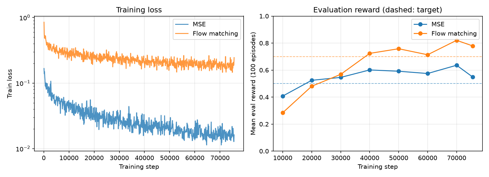

# 심층 강화학습 공부 기록: UC Berkeley CS 285 과제 (독학)

[English](README.md) | **한국어**

UC Berkeley의 **CS 285: Deep Reinforcement Learning, Decision Making, and Control (2026년 봄)** 과제를
직접 풀면서 심층 강화학습을 독학하고 있습니다. 이 저장소는 그 과정을 진행되는 대로 기록합니다.
아직 완전히 이해하지 못한 부분도 함께 적습니다.

> **출처.** 시작 코드, 과제 구성, 환경은
> [berkeleydeeprlcourse/homework_spring2026](https://github.com/berkeleydeeprlcourse/homework_spring2026)에서
> 가져왔으며, MIT 라이선스로 공개되어 있습니다 (Copyright (c) 2026 berkeleydeeprlcourse, [LICENSE](LICENSE) 참고).
> 저는 이 수업의 수강생이 아니며 UC Berkeley와 관련이 없습니다. 제가 바꾼 부분은
> [아래](#내가-바꾼-부분)에 정리했습니다.

## 왜 하는가

**로봇 학습, 특히 VLA(vision-language-action) 모델과 강화학습**을 연구하는 대학원 연구실에 지원하려고
준비하고 있습니다. 컴퓨터공학을 전공했고, 딥러닝·컴퓨터비전 부트캠프를 수료했으며, 지금은 로봇
매니퓰레이션 프로젝트에서 인턴으로 일하고 있습니다. 강화학습은 처음이라, 실제 코딩 과제가 있는 잘 알려진
강의를 골라 과제를 제대로 끝내 보기로 했습니다.

## 지금 어디쯤인지 솔직하게

- **아직 이해하는 중입니다.** MLP, Adam, 학습 루프 같은 딥러닝 기초는 부트캠프에서 배웠습니다. 하지만 이
  코드는 제가 배운 "노트북 한 장" 스타일과 구성이 다릅니다. 손실이 정책 안(`compute_loss`)에 있고, 설정은
  데이터클래스와 터미널 옵션으로 받으며, 평가는 시뮬레이터를 직접 돌립니다. 모든 부분을 이해하는 데 시간이
  걸리고 있습니다.
- **이렇게 채워 가고 있습니다.** 작업하는 파일마다 한 줄씩 한글 주석을 달고 있습니다. 함수마다 무엇을 받아서,
  무엇을 하고, 무엇을 돌려주는지 적습니다. 수식도 작은 숫자 예시로 다시 풀어 봅니다. 지금 다 안다고 말하기보다,
  **과제를 하나씩 할수록 더 깊이 이해하는 것**이 목표입니다.
- **LLM(Claude)을 적극적인 튜터로 쓰고 있습니다.** 개념 설명, 제 설명이 맞는지 확인, 디버깅에 활용합니다.
  누가 무엇을 썼는지 투명하게 밝힙니다.

| HW1 부분 | 어떻게 만들었나 |
|---|---|
| `MSEPolicy` | LLM이 구현과 한 줄씩 설명을 제공했고, 제가 공부해서 각 줄을 설명할 수 있습니다 |
| 학습 루프 (`train.py`) | 빈칸이 있는 뼈대를 제가 채웠고, 제 버그(`==` 오타, 잘못된 함수 이름)를 직접 고쳤습니다 |
| `FlowMatchingPolicy` | LLM이 빈칸 5개짜리 뼈대를 주었고, VS Code 자동완성이 빈칸을 채웠습니다. 이후 빈칸마다 수식과 맞는지 확인했습니다 |
| 한 줄씩 단 한글 주석 | LLM과 함께 공부 노트로 작성했고, 읽어 보며 참고 자료로 남겼습니다 |
| 학습 실행, 그래프, 영상 비교 | 제 노트북 GPU로 돌렸고, 영상 비교는 제가 직접 영상을 보고 관찰한 내용입니다 |

## LLM과 함께 만든 공부 교재

CS 285 강의는 영어인 데다 수식이 빠르게 전개되어, 강화학습을 처음 배우는 제게는 너무 어려웠습니다. 그래서
LLM(Claude)을 이용해 2~8강 내용을 한국어로 다시 풀어 쓴 **동행 교재**를 만들고, 이 교재로 공부하며 과제를 풀고
있습니다: [**study-guide/cs285-study-guide-ko.pdf**](study-guide/cs285-study-guide-ko.pdf) (60쪽)

- **내용:** 모방학습, 오류 누적(O(εT²)), DAgger, MDP, 정책 경사, 액터-크리틱, Q러닝. 한 쪽에 개념 하나씩,
  직관 → 수식 → 숫자 예시 → 퀴즈 순서로 구성했습니다.
- **출처:** Sergey Levine 교수의 CS 285 공개 강의 슬라이드(2026년판)와 강의 영상을 바탕으로 했습니다. 슬라이드를
  번역하거나 복사한 것이 아니라 새로 쓴 해설입니다.
- **주의:** LLM과 함께 썼고 공부하면서 계속 검토하고 있어서, 틀린 부분이 있을 수 있습니다. 정확한 내용은 원래 강의
  자료를 기준으로 삼아 주세요.

## 진행 상황

| 과제 | 주제 | 상태 |
|---|---|---|
| [HW1](hw1/) | 모방학습: MSE와 flow matching으로 액션 청킹 (Push-T) | ✅ 완료 (2026-11-10) |
| HW2 | 정책 경사: reward-to-go, 기준선, GAE | ⏳ 다음 |
| HW3 | Q러닝과 액터-크리틱: DQN, Double DQN, SAC | ⏳ 예정 |

## HW1: Push-T 모방학습

**과제.** T자 블록을 밀어서 목표 영역에 맞추는 과제입니다. 상태는 5개(로봇 x, y와 블록 x, y, 각도),
행동은 2개(목표 위치)입니다. 두 정책 모두 행동 8개를 한 번에 예측하고, 그 8개를 다시 관측하지 않고 그대로 실행합니다.

### 결과

| 정책 | 목표 | 최종 평가 점수 | 최고 평가 점수 |
|---|---|---|---|
| MSE | 0.5 이상 | **0.548** | 0.636 (7만 스텝) |
| Flow matching | 0.7 이상 | **0.779** | 0.821 (7만 스텝) |

평가 점수는 100판 각각에서 받은 최고 점수의 평균입니다.



W&B에 기록된 값으로 [`hw1/plot_curves.py`](hw1/plot_curves.py)를 써서 그렸습니다. 두 손실 곡선은 값을
서로 비교할 수 없습니다. MSE 정책은 행동을 맞히고 flow 정책은 노이즈가 섞인 속도를 맞히기 때문에, flow 쪽
손실은 원래 더 높게 유지됩니다.

### 구조

두 정책은 같은 MLP 뼈대를 씁니다. 은닉층 3개(각 256)에 ReLU 활성화를 쓰고, 출력 16개를 8 × 2 행동 묶음으로
바꿉니다.

- **MSE 정책:** 상태 5개를 바로 행동 묶음으로 바꿉니다 (파라미터 137,232개).
- **Flow matching 정책:** 상태, 지금의 노이즈 섞인 묶음(16개), flow 진행도 τ를 합쳐 22개를 입력으로 받습니다.
  출력은 묶음과 같은 모양의 속도입니다 (파라미터 141,584개). 실행할 때는 가우시안 노이즈에서 출발해
  오일러 적분 10걸음으로 행동을 만듭니다.
- **학습:** Adam(학습률 3e-4, weight decay 없음), 배치 128, 청크 8, 400 에폭(약 7.56만 스텝), 시드 42.

### 영상에서 보인 것

T의 어느 쪽으로 돌아갈지 정하는 갈림길에서 MSE 정책은 자주 머뭇거리거나 가운데 경로로 흐르고, flow matching
정책은 한쪽을 골라 확실히 갑니다. 움직임도 flow 정책이 더 부드럽고, 마지막 정렬 단계에서 T를 더 정확히
맞춥니다 (예: 에피소드 4). 이는 MSE 회귀가 여러 갈래의 전문가 행동을 평균 내고, flow matching은 그중 하나의
일관된 행동을 뽑는다는 예상과 맞습니다.

### 배운 것

- **MSE가 막히는 이유.** 전문가가 어떨 때는 왼쪽(−1), 어떨 때는 오른쪽(+1)으로 가면, MSE를 최소로 만드는
  행동은 그 평균(0)이고 이건 어느 쪽도 아닙니다. 실제로 MSE 정책은 학습 손실이 계속 줄어드는데도 점수가
  0.55~0.64에서 멈췄습니다.
- **Flow matching이 다른 점.** 무작위 노이즈를 실제 행동으로 옮기는 속도장을 배웁니다. 그래서 노이즈가 다르면
  평균이 아니라 서로 다른 갈래(정답) 중 하나에 도착합니다. π0 같은 VLA 모델도 행동을 만드는 부분에 같은
  아이디어를 씁니다.
- **오류 누적과의 연결.** 행동 복제의 오류는 O(εT²)로 커질 수 있습니다. 정책이 자기 실수 때문에 시연에 없던
  상태로 가기 때문입니다. 액션 청킹은 결정 횟수를 줄여 주므로 이 문제를 줄이는 데 도움이 됩니다.

### 다시 실행하기

```bash
cd hw1
uv run src/hw1_imitation/train.py --policy-type mse --exp-name mse
uv run src/hw1_imitation/train.py --policy-type flow --exp-name flow
uv run --with matplotlib python plot_curves.py
```

`uv`와 W&B 설치 방법은 원래 강의 저장소에 있던 [hw1/README.md](hw1/README.md)를 참고하세요.

## 내가 바꾼 부분

원래 저장소와 비교해서:

- `hw1/src/hw1_imitation/model.py`: `MSEPolicy`, `FlowMatchingPolicy` 구현
- `hw1/src/hw1_imitation/train.py`: 학습 루프 구현
- `hw1/src/hw1_imitation/` 안의 모든 파일: 한글 공부 주석 추가 (그 외 코드 변경 없음)
- `hw1/plot_curves.py`, `hw1/plots/`: 학습 곡선 스크립트와 그림
- `hw1/.gitignore`: 로컬 짧은 실행 기록(`exp_smoke/`)은 올리지 않도록 추가
- `study-guide/cs285-study-guide-ko.pdf`: LLM과 함께 만든 한국어 공부 교재
- `README.md`, `README.ko.md`: 이 공부 기록

나머지 과제(`hw2`~`hw5`, 기말 프로젝트)는 아직 원래 시작 코드 그대로입니다.
