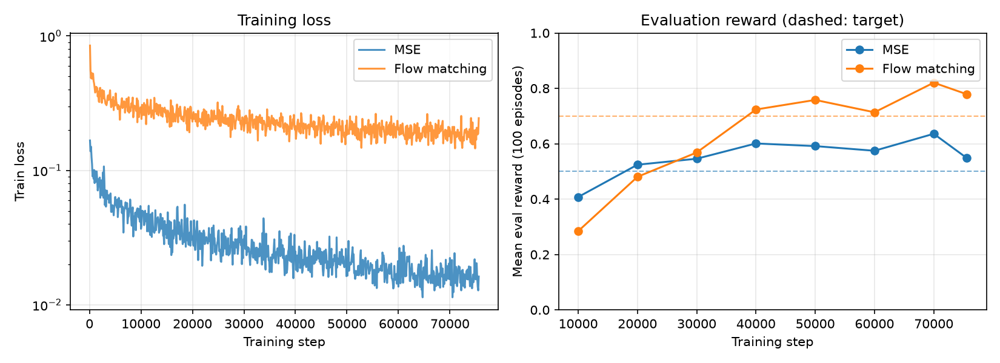
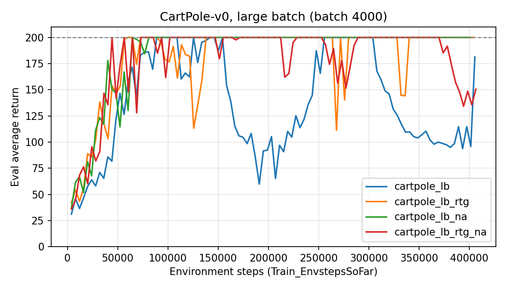

# Deep RL Study Log: UC Berkeley CS 285 Homework (Self-Study)

**English** | [한국어](README.ko.md)

I am self-studying deep reinforcement learning by working through the homework of
UC Berkeley's **CS 285: Deep Reinforcement Learning, Decision Making, and Control (Spring 2026)**.
This repository records that work as it happens, including what I have not fully understood yet.

> **Attribution.** The starter code, assignment structure, and environments come from
> [berkeleydeeprlcourse/homework_spring2026](https://github.com/berkeleydeeprlcourse/homework_spring2026),
> released under the MIT License (Copyright (c) 2026 berkeleydeeprlcourse; see [LICENSE](LICENSE)).
> I am not enrolled in the course and am not affiliated with UC Berkeley. My own changes are listed
> [below](#what-i-changed).

## Why I am doing this

I am preparing to apply to graduate research labs working on **robot learning, especially
vision-language-action (VLA) models and reinforcement learning**. I have a computer science background,
completed a deep learning and computer vision bootcamp, and work as an intern on a robot manipulation
project. Reinforcement learning is new to me, so I chose a well-known course with real coding
assignments and set out to complete them seriously.

## An honest note on where I am

- **Understanding is still in progress.** I know the deep learning basics (MLPs, Adam, training loops)
  from my bootcamp. But this codebase is organized differently from the single-notebook style I learned
  in: the loss lives inside the policy (`compute_loss`), settings come from a config dataclass and the
  command line, and evaluation runs a simulator. It is taking me time to understand every part.
- **How I am closing the gap.** I am annotating every file I work on, line by line, with Korean
  comments covering what each function takes in, what it does, and what it returns. I also re-derive
  the math with small numeric examples. My goal is to understand more with each assignment, not to
  claim full mastery now.
- **I use an LLM (Claude) as an active tutor.** I use it to explain concepts, check my explanations,
  and help debug. I want to be transparent about who wrote what:

| Part of HW1 | How it was produced |
|---|---|
| `MSEPolicy` | The LLM provided the implementation and explained it line by line; I studied it and can explain each line |
| Main training loop (`train.py`) | I filled in a skeleton with blanks and fixed my own bugs (a `==` typo and a wrong method name) |
| `FlowMatchingPolicy` | The LLM gave a skeleton with 5 blanks; VS Code autocomplete filled them; I then checked each blank against the math |
| Korean line-by-line comments | Written with the LLM as study notes, then read through and kept as my reference |
| Training runs, plots, video comparison | Run on my laptop GPU; the qualitative comparison is from my own viewing of the rollout videos |

## Study guide I made with an LLM

The CS 285 lectures were hard for me as a newcomer to RL: they are in English and the math moves fast.
So I used an LLM (Claude) to build a **Korean companion study guide** for lectures 2–8 and study from it
while doing the homework: [**study-guide/cs285-study-guide-ko.pdf**](study-guide/cs285-study-guide-ko.pdf)
(60 pages).

- **Content:** imitation learning, compounding errors (O(εT²)), DAgger, MDPs, policy gradients,
  actor-critic, and Q-learning. Each page covers one concept as intuition, then math, then a worked numeric
  example, then a quiz.
- **Source:** based on the public CS 285 lecture slides (Spring 2026) and videos by Prof. Sergey Levine.
  It re-explains the material in new words; it is not a translation or copy of the slides.
- **Caveat:** written together with an LLM and still being checked as I study, so it may contain errors.
  The original course materials are authoritative.

## Progress

| Assignment | Topic | Status |
|---|---|---|
| [HW1](hw1/) | Imitation learning: action chunking with MSE and flow matching (Push-T) | ✅ Done (2026-11-10) |
| [HW2](hw2/) | Policy gradients: reward-to-go, baselines, GAE | 🔄 In progress (Experiment 1 done) |
| HW3 | Q-learning and actor-critic: DQN, Double DQN, SAC | ⏳ Planned |

## HW1: Imitation Learning on Push-T

**Task.** Push a T-shaped block into a goal region. The state has 5 values (agent x, y and block x, y,
angle); the action has 2 values (target position). Both policies predict a chunk of 8 actions at once
and execute it open-loop.

### Results

| Policy | Target | Final eval reward | Best eval reward |
|---|---|---|---|
| MSE | ≥ 0.5 | **0.548** | 0.636 (step 70k) |
| Flow matching | ≥ 0.7 | **0.779** | 0.821 (step 70k) |

Eval reward is the mean over 100 episodes of each episode's maximum reward.



Generated with [`hw1/plot_curves.py`](hw1/plot_curves.py) from the logged W&B history. The two loss
curves are not comparable in value: the MSE policy regresses actions, while the flow policy regresses
noisy velocities, so its loss stays higher by design.

### Architecture

Both policies use the same MLP backbone: three hidden layers of 256 units with ReLU activations. The
output is a 16-dimensional vector reshaped into an 8 × 2 action chunk.

- **MSE policy:** maps the 5-dimensional state directly to the action chunk (137,232 parameters).
- **Flow matching policy:** takes the state, the current noisy chunk (16 values), and the flow timestep
  τ, for 22 inputs in total. It predicts a velocity of the same shape as the chunk (141,584 parameters).
  At inference it integrates from Gaussian noise with 10 Euler steps.
- **Training:** Adam (learning rate 3e-4, no weight decay), batch size 128, chunk size 8, 400 epochs
  (about 75.6k steps), seed 42.

### What the videos show

At decision points, such as choosing which side of the T to push around, the MSE policy often hesitates
or drifts toward a middle path, while the flow matching policy commits to one side. The flow policy also
moves more smoothly. In the final alignment phase it places the T more precisely, for example in
episode 4. This matches the expectation that MSE regression averages over multimodal expert actions,
whereas flow matching samples one coherent mode.

### What I learned

- **Why MSE gets stuck.** When the expert sometimes goes left (−1) and sometimes right (+1), the action
  that minimizes MSE is their average (0), which is neither. My MSE policy's reward plateaued at
  0.55–0.64 even as its training loss kept falling.
- **What flow matching does differently.** It learns a velocity field that carries random noise to a
  real action, so different noise samples end in different modes instead of their average. The same
  idea is used as the action head of VLA models such as π0.
- **The link to compounding errors.** Behavior cloning errors can grow as O(εT²) because the policy's
  own mistakes lead it to states not in the demonstrations. Action chunking reduces the number of
  decisions, which is one reason it helps.

### Reproduce

```bash
cd hw1
uv run src/hw1_imitation/train.py --policy-type mse --exp-name mse
uv run src/hw1_imitation/train.py --policy-type flow --exp-name flow
uv run --with matplotlib python plot_curves.py
```

See [hw1/README.md](hw1/README.md) (from the original course repository) for setup with `uv` and W&B.

## HW2: Policy Gradients (in progress)

Implemented so far: rollout collection (`utils.py`), the policy's action sampling and policy-gradient
loss (`policies.py`), discounted return and reward-to-go, advantage normalization (`pg_agent.py`), and the
training loop (`run.py`). Neural-network baseline and GAE are next.

How the HW2 code was written: for each TODO, the LLM first gave me a similar example (and a skeleton
with blanks when I got stuck); I wrote the lines myself, and the LLM reviewed them. My mistakes it caught
included calling functions by the wrong name, `np.from_numpy` instead of `np.concatenate`, and passing
`rewards`/`terminals` in the wrong order.

### Experiment 1: CartPole (8 runs, 100 iterations each, seed 1)

| Run | Batch | Final eval return | First env step at return 200 |
|---|---|---|---|
| `cartpole` | 1000 | 97.4 | not reached |
| `cartpole_rtg` | 1000 | 112.5 | 24,481 |
| `cartpole_na` | 1000 | **200** | 16,409 |
| `cartpole_rtg_na` | 1000 | **200** | **12,595** |
| `cartpole_lb` | 4000 | 181.3 | 88,881 |
| `cartpole_lb_rtg` | 4000 | **200** | 60,630 |
| `cartpole_lb_na` | 4000 | **200** | 64,525 |
| `cartpole_lb_rtg_na` | 4000 | 150.7 | 44,444 |




Before running, I wrote down predictions. Two of three were wrong, which taught me the most:

| Question | My prediction | Result |
|---|---|---|
| Full-trajectory return vs reward-to-go | Full return better | ❌ Reward-to-go was better: it stops crediting the actions that made the pole fall, which lowers variance |
| Advantage normalization | Helps | ✅ Helped most. CartPole rewards are always +1, so subtracting the mean acts like a baseline |
| Large batch (4000) vs small (1000), per environment step | Large learns faster | ❌ Small batch reached 200 in fewer steps: it updates 4× more often for the same data |

Caveat: one seed per setting, so some drops (e.g. `cartpole_lb_rtg_na` at the end) may be noise.

## What I changed

Compared with the original repository:

- `hw1/src/hw1_imitation/model.py`: implemented `MSEPolicy` and `FlowMatchingPolicy`
- `hw1/src/hw1_imitation/train.py`: implemented the main training loop
- All files in `hw1/src/hw1_imitation/`: added Korean study comments (no other code changes)
- `hw1/plot_curves.py`, `hw1/plots/`: training curve script and figure
- `hw1/.gitignore`: ignore my local smoke-test runs (`exp_smoke/`)
- `study-guide/cs285-study-guide-ko.pdf`: my LLM-assisted Korean study guide
- `README.md`, `README.ko.md`: this study log

- `hw2/src/`: rollout, policy, return/advantage, and training-loop TODOs (baseline and GAE not yet)
- `hw2/plot_cartpole.py`, `hw2/plots/`: Experiment 1 plot script and figures

The other assignments (`hw3` to `hw5` and the final projects) are still the original starter code.
