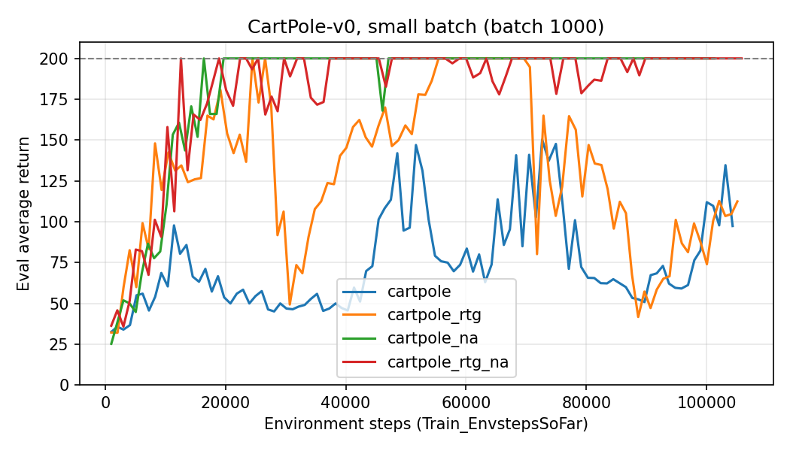
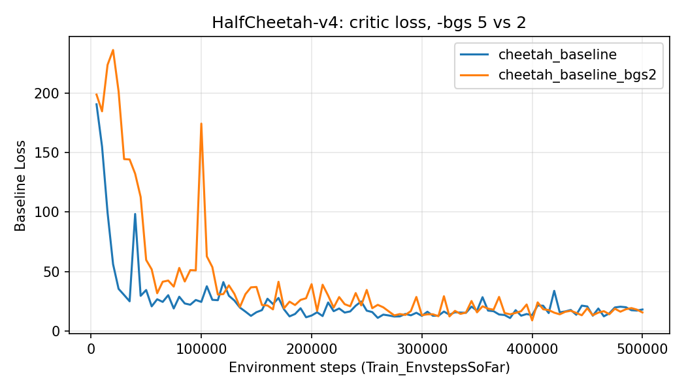
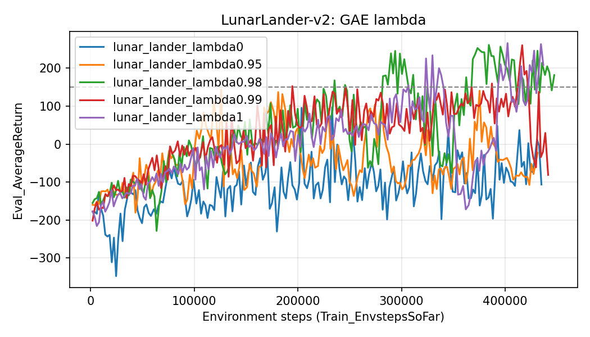

# Deep RL Study Log: UC Berkeley CS 285 Homework (Self-Study)

**English** | [한국어](README.ko.md)

I am self-studying deep reinforcement learning by working through the homework of
UC Berkeley's **CS 285: Deep Reinforcement Learning, Decision Making, and Control (Spring 2026)**.
This repository records that work as it happens, including what I have not fully understood yet.

> **Attribution.** The starter code, assignment structure, and environments come from
> [berkeleydeeprlcourse/homework_spring2026](https://github.com/berkeleydeeprlcourse/homework_spring2026),
> released under the MIT License (Copyright (c) 2026 berkeleydeeprlcourse; see [LICENSE](LICENSE)).
> I am not enrolled in the course and am not affiliated with UC Berkeley. My own changes are listed
> [below](#what-i-changed).

## Why I am doing this

I am preparing to apply to graduate research labs working on **robot learning, especially
vision-language-action (VLA) models and reinforcement learning**. I have a computer science background,
completed a deep learning and computer vision bootcamp, and work as an intern on a robot manipulation
project. Reinforcement learning is new to me, so I chose a well-known course with real coding
assignments and set out to complete them seriously.

## An honest note on where I am

- **Understanding is still in progress.** I know the deep learning basics (MLPs, Adam, training loops)
  from my bootcamp. But this codebase is organized differently from the single-notebook style I learned
  in: the loss lives inside the policy (`compute_loss`), settings come from a config dataclass and the
  command line, and evaluation runs a simulator. It is taking me time to understand every part.
- **How I am closing the gap.** I am annotating every file I work on, line by line, with Korean
  comments covering what each function takes in, what it does, and what it returns. I also re-derive
  the math with small numeric examples. My goal is to understand more with each assignment, not to
  claim full mastery now.
- **I use an LLM (Claude) as an active tutor.** I use it to explain concepts, check my explanations,
  and help debug. I want to be transparent about who wrote what:

| Part of HW1 | How it was produced |
|---|---|
| `MSEPolicy` | The LLM provided the implementation and explained it line by line; I studied it and can explain each line |
| Main training loop (`train.py`) | I filled in a skeleton with blanks and fixed my own bugs (a `==` typo and a wrong method name) |
| `FlowMatchingPolicy` | The LLM gave a skeleton with 5 blanks; VS Code autocomplete filled them; I then checked each blank against the math |
| Korean line-by-line comments | Written with the LLM as study notes, then read through and kept as my reference |
| Training runs, plots, video comparison | Run on my laptop GPU; the qualitative comparison is from my own viewing of the rollout videos |

## Study guide I made with an LLM

The CS 285 lectures were hard for me as a newcomer to RL: they are in English and the math moves fast.
So I used an LLM (Claude) to build a **Korean companion study guide** for lectures 2–8 and study from it
while doing the homework: [**study-guide/cs285-study-guide-ko.pdf**](study-guide/cs285-study-guide-ko.pdf)
(60 pages).

- **Content:** imitation learning, compounding errors (O(εT²)), DAgger, MDPs, policy gradients,
  actor-critic, and Q-learning. Each page covers one concept as intuition, then math, then a worked numeric
  example, then a quiz.
- **Source:** based on the public CS 285 lecture slides (Spring 2026) and videos by Prof. Sergey Levine.
  It re-explains the material in new words; it is not a translation or copy of the slides.
- **Caveat:** written together with an LLM and still being checked as I study, so it may contain errors.
  The original course materials are authoritative.

### Equation notes for each assignment

While doing the homework I also wrote notes (in Korean) that unpack each equation in the assignment PDFs.
I made them by asking an LLM (Claude and others) questions, then read and edited them as my study record.

| File | Content |
|---|---|
| [hw1/hw1_수식정리.md](hw1/hw1_수식정리.md) | HW1 Eqs. 1–3: MSE loss, flow matching loss, Euler integration |
| [hw2/hw2_수식정리.md](hw2/hw2_수식정리.md) | HW2 Eqs. 1–26: policy gradient derivation, reward-to-go, baselines, GAE, normalization |
| [hw2/src/agents/용어정리.md](hw2/src/agents/용어정리.md) | Analogies for lectures 6–7 and the flow of the HW2 code |
| [study-guide/HW1-HW2_수식정리.pdf](study-guide/HW1-HW2_수식정리.pdf) | The two equation notes merged into one PDF (15 pages). The notes are unchanged; the LLM added numeric examples, links to the code, and the missing Eqs. (19)–(20) as blue "supplement" boxes |

Like the study guide, these may contain errors.

## Progress

| Assignment | Topic | Status |
|---|---|---|
| [HW1](hw1/) | Imitation learning: action chunking with MSE and flow matching (Push-T) | ✅ Done (2026-11-10) |
| [HW2](hw2/) | Policy gradients: reward-to-go, baselines, GAE | ✅ Done (2026-11-17) |
| HW3 | Q-learning and actor-critic: DQN, Double DQN, SAC | ⏳ Planned |

## HW1: Imitation Learning on Push-T

**Task.** Push a T-shaped block into a goal region. The state has 5 values (agent x, y and block x, y,
angle); the action has 2 values (target position). Both policies predict a chunk of 8 actions at once
and execute it open-loop.

### Results

| Policy | Target | Final eval reward | Best eval reward |
|---|---|---|---|
| MSE | ≥ 0.5 | **0.548** | 0.636 (step 70k) |
| Flow matching | ≥ 0.7 | **0.779** | 0.821 (step 70k) |

Eval reward is the mean over 100 episodes of each episode's maximum reward.


Generated with [`hw1/plot_curves.py`](hw1/plot_curves.py) from the logged W&B history. The two loss
curves are not comparable in value: the MSE policy regresses actions, while the flow policy regresses
noisy velocities, so its loss stays higher by design.

### Architecture

Both policies use the same MLP backbone: three hidden layers of 256 units with ReLU activations. The
output is a 16-dimensional vector reshaped into an 8 × 2 action chunk.

- **MSE policy:** maps the 5-dimensional state directly to the action chunk (137,232 parameters).
- **Flow matching policy:** takes the state, the current noisy chunk (16 values), and the flow timestep
  τ, for 22 inputs in total. It predicts a velocity of the same shape as the chunk (141,584 parameters).
  At inference it integrates from Gaussian noise with 10 Euler steps.
- **Training:** Adam (learning rate 3e-4, no weight decay), batch size 128, chunk size 8, 400 epochs
  (about 75.6k steps), seed 42.

### What the videos show

At decision points, such as choosing which side of the T to push around, the MSE policy often hesitates
or drifts toward a middle path, while the flow matching policy commits to one side. The flow policy also
moves more smoothly. In the final alignment phase it places the T more precisely, for example in
episode 4. This matches the expectation that MSE regression averages over multimodal expert actions,
whereas flow matching samples one coherent mode.

### What I learned

- **Why MSE gets stuck.** When the expert sometimes goes left (−1) and sometimes right (+1), the action
  that minimizes MSE is their average (0), which is neither. My MSE policy's reward plateaued at
  0.55–0.64 even as its training loss kept falling.
- **What flow matching does differently.** It learns a velocity field that carries random noise to a
  real action, so different noise samples end in different modes instead of their average. The same
  idea is used as the action head of VLA models such as π0.
- **The link to compounding errors.** Behavior cloning errors can grow as O(εT²) because the policy's
  own mistakes lead it to states not in the demonstrations. Action chunking reduces the number of
  decisions, which is one reason it helps.

### Reproduce

```bash
cd hw1
uv run src/hw1_imitation/train.py --policy-type mse --exp-name mse
uv run src/hw1_imitation/train.py --policy-type flow --exp-name flow
uv run --with matplotlib python plot_curves.py
```

See [hw1/README.md](hw1/README.md) (from the original course repository) for setup with `uv` and W&B.

## HW2: Policy Gradients

Implemented so far: rollout collection (`utils.py`), the policy's action sampling and policy-gradient
loss (`policies.py`), discounted return and reward-to-go, advantage normalization (`pg_agent.py`), and the
training loop (`run.py`), the neural-network critic (`critics.py`), and GAE (`pg_agent.py`). All four
experiments are done.

How the HW2 code was written: for each TODO, the LLM first gave me a similar example (and a skeleton
with blanks when I got stuck); I wrote the lines myself, and the LLM reviewed them. My mistakes it caught
included calling functions by the wrong name, `np.from_numpy` instead of `np.concatenate`, and passing
`rewards`/`terminals` in the wrong order.

### Experiment 1: CartPole (8 runs, 100 iterations each, seed 1)

| Run | Batch | Final eval return | First env step at return 200 |
|---|---|---|---|
| `cartpole` | 1000 | 97.4 | not reached |
| `cartpole_rtg` | 1000 | 112.5 | 24,481 |
| `cartpole_na` | 1000 | **200** | 16,409 |
| `cartpole_rtg_na` | 1000 | **200** | **12,595** |
| `cartpole_lb` | 4000 | 181.3 | 88,881 |
| `cartpole_lb_rtg` | 4000 | **200** | 60,630 |
| `cartpole_lb_na` | 4000 | **200** | 64,525 |
| `cartpole_lb_rtg_na` | 4000 | 150.7 | 44,444 |




Before running, I wrote down predictions. Two of three were wrong, which taught me the most:

| Question | My prediction | Result |
|---|---|---|
| Full-trajectory return vs reward-to-go | Full return better | ❌ Reward-to-go was better: it stops crediting the actions that made the pole fall, which lowers variance |
| Advantage normalization | Helps | ✅ Helped most. CartPole rewards are always +1, so subtracting the mean acts like a baseline |
| Large batch (4000) vs small (1000), per environment step | Large learns faster | ❌ Small batch reached 200 in fewer steps: it updates 4× more often for the same data |

Caveat: one seed per setting, so some drops (e.g. `cartpole_lb_rtg_na` at the end) may be noise.

Commands:

```bash
# Experiment 1: CartPole (other settings at their defaults)
uv run src/scripts/run.py --env_name CartPole-v0 -n 100 -b 1000 --exp_name cartpole
uv run src/scripts/run.py --env_name CartPole-v0 -n 100 -b 1000 -rtg --exp_name cartpole_rtg
uv run src/scripts/run.py --env_name CartPole-v0 -n 100 -b 1000 -na --exp_name cartpole_na
uv run src/scripts/run.py --env_name CartPole-v0 -n 100 -b 1000 -rtg -na --exp_name cartpole_rtg_na
uv run src/scripts/run.py --env_name CartPole-v0 -n 100 -b 4000 --exp_name cartpole_lb
uv run src/scripts/run.py --env_name CartPole-v0 -n 100 -b 4000 -rtg --exp_name cartpole_lb_rtg
uv run src/scripts/run.py --env_name CartPole-v0 -n 100 -b 4000 -na --exp_name cartpole_lb_na
uv run src/scripts/run.py --env_name CartPole-v0 -n 100 -b 4000 -rtg -na --exp_name cartpole_lb_rtg_na
```

### Experiment 2: HalfCheetah with a neural-network baseline (3 runs, 100 iterations each, seed 1)

A critic V(s) is trained by MSE to predict reward-to-go, and the advantage is `Q − V`. `-bgs` is how many
critic updates are made per batch of data.

| Run | Setting | Final eval return | Best | Target 300 |
|---|---|---|---|---|
| `cheetah` | no baseline | −310.6 | −245.3 | ❌ |
| `cheetah_baseline` | baseline, `-bgs 5` | **383.2** | **421.8** | ✅ |
| `cheetah_baseline_bgs2` | baseline, `-bgs 2` | 219.2 | 249.5 | ❌ |




| Question | My prediction | Result |
|---|---|---|
| Does a baseline help? | Yes | ✅ By a wide margin (−311 vs 383). Rewards vary a lot here, so subtracting a baseline removes much of the noise |
| Reducing `-bgs` from 5 to 2 | (I first had to ask what `-bgs` means) | The critic loss falls more slowly and spikes during the first 100k steps. While the critic is inaccurate the baseline helps less, and the final return drops from 383 to 219 |

Lesson: the actor learns well only when the critic is accurate. Same caveat as Experiment 1: one seed.

### Experiment 3: LunarLander, GAE λ sweep (5 runs, 200 iterations each, seed 1)

GAE is implemented with the backward recursion $A_t = \delta_t + \gamma\lambda A_{t+1}$, multiplying by
`1 - terminals[i]` so that values from the next trajectory in the batch do not leak in. Eval return swings
a lot between iterations, so the table also reports the mean over the last 20 iterations.

| λ | Mean of last 20 | Best | First iteration ≥ 150 |
|---|---|---|---|
| 0 | −59.1 | 96.9 | never |
| 0.95 | −61.4 | 144.4 | never |
| 0.98 | **172.8** | 261.4 | 105 |
| 0.99 | 84.5 | 260.6 | 88 |
| 1 | **171.5** | 266.1 | 139 |



| Question | My prediction | Result |
|---|---|---|
| λ = 0 (one-step TD) | Fails | ✅ Stayed negative. It trusts only the critic, which is inaccurate early on (high bias) |
| 0.95–0.99 vs λ = 1 | 0.95–0.99 better | 🔸 Half right. 0.98 matched λ = 1, but 0.95 was worse |

Interpretation: what is clear is that λ = 0 is bad and only λ close to 1 crossed 150. LunarLander pays a large
reward at touchdown, so looking further ahead with real rewards seems to help. The ranking within 0.95–1 is
not reliable from one seed given how noisy the curves are.

### Experiment 4: InvertedPendulum tuning (goal: return 1000 within 100k environment steps)

| Run | Settings | First env step at 1000 | Best within 100k |
|---|---|---|---|
| `pendulum_default` | `-b 5000`, nothing else | 411,367 | 56 |
| `pendulum_na_gae` | `-b 5000 -rtg -na --use_baseline --gae_lambda 0.98` | not reached (only 20 updates) | 113 |
| `pendulum_na_gae_b1000` | `-b 1000 -rtg -na --use_baseline --gae_lambda 0.98` | **62,211** ✅ | **1000** |


Best command:

```bash
uv run src/scripts/run.py --env_name InvertedPendulum-v4 -n 100 -b 1000 -eb 1000 \
  -rtg -na --use_baseline --gae_lambda 0.98 --exp_name pendulum_na_gae_b1000
```

Between these two tuned runs, **batch size** made the difference. With `-b 5000`, 100k steps allow only 20 policy updates, so even the
normalization, baseline, and GAE that I chose could not get past 113. With `-b 1000`, the same settings get 100
updates and reach 1000 at about 62k steps. The default run did reach 1000 once, at 411k steps, but then
collapsed to 46.

My prediction was that large batches learn faster, which I misremembered from Experiment 1. Experiment 1
had already shown the opposite (per environment step, small batches win), and this experiment confirmed it.
One seed, and the tuned curve still oscillates between 1000 and ~150 before settling.

**Ablation: which knob actually mattered?** The comparison above changes four knobs at once, so I ran three
more runs with `-b 1000`, turning knobs on one at a time. Before running, I predicted that batch size alone
would be enough, that runs without a baseline or GAE would fail, and that GAE was necessary.

| Run (all `-b 1000`) | Knobs on | First env step at 1000 | Mean of last 10 |
|---|---|---|---|
| `pendulum_b1000` | none | not reached (best 120) | 62 |
| `pendulum_b1000_rtg_na` | `-rtg -na` | 77,086 | 935 |
| `pendulum_b1000_rtg_na_base` | `-rtg -na --use_baseline` | 91,314 | 763 |
| `pendulum_na_gae_b1000` | `-rtg -na --use_baseline --gae_lambda 0.98` | **62,211** | **1000** |


| My prediction | Result |
|---|---|
| Batch size alone is enough | ❌ Best was 120. Frequent updates do not help when each gradient is this noisy |
| Without a baseline or GAE it fails | ❌ Reward-to-go plus normalization alone reached 1000 at 77k steps |
| GAE is necessary | 🔸 Not necessary, but fastest and the only run that stayed at 1000 |

What I take from this: the key was **small batches combined with variance reduction**, since neither alone
worked. Normalization already subtracts the batch mean, so it acts much like a baseline, which is why adding
the critic baseline did not help further here (the slower 91k may just be seed noise). GAE builds on the
critic rather than replacing reward-to-go and the baseline: it trades some critic bias for lower variance,
and here that showed up as stability. All runs use one seed.

### Commands for Experiments 2–3

```bash
# Experiment 2: HalfCheetah
C="--env_name HalfCheetah-v4 -n 100 -b 5000 -eb 3000 -rtg --discount 0.95 -lr 0.01"
uv run src/scripts/run.py $C --exp_name cheetah
uv run src/scripts/run.py $C --use_baseline -blr 0.01 -bgs 5 --exp_name cheetah_baseline
uv run src/scripts/run.py $C --use_baseline -blr 0.01 -bgs 2 --exp_name cheetah_baseline_bgs2

# Experiment 3: LunarLander, for λ in 0 0.95 0.98 0.99 1
uv run src/scripts/run.py --env_name LunarLander-v2 --ep_len 1000 --discount 0.99 -n 200 -b 2000 -eb 2000 \
  -l 3 -s 128 -lr 0.001 --use_reward_to_go --use_baseline --gae_lambda <λ> --exp_name lunar_lander_lambda<λ>
```

λ = 0 makes the advantage the one-step TD error δ_t (low variance, biased by the critic); λ = 1 makes it
reward-to-go minus V(s_t) (unbiased, high variance).

## What I changed

Compared with the original repository:

- `hw1/src/hw1_imitation/model.py`: implemented `MSEPolicy` and `FlowMatchingPolicy`
- `hw1/src/hw1_imitation/train.py`: implemented the main training loop
- All files in `hw1/src/hw1_imitation/`: added Korean study comments (no other code changes)
- `hw1/plot_curves.py`, `hw1/plots/`: training curve script and figure
- `hw1/.gitignore`: ignore my local smoke-test runs (`exp_smoke/`)
- `study-guide/cs285-study-guide-ko.pdf`: my LLM-assisted Korean study guide
- `hw1/hw1_수식정리.md`, `hw2/hw2_수식정리.md`, `hw2/src/agents/용어정리.md`, `study-guide/HW1-HW2_수식정리.pdf`:
  LLM-assisted equation notes
- `README.md`, `README.ko.md`: this study log

- `hw2/src/`: rollout, policy, return/advantage, and training-loop TODOs, including the critic baseline and GAE
- `hw2/plot_cartpole.py`, `hw2/plot_experiments.py`, `hw2/plots/`: plot scripts and figures for Experiments 1–4

The other assignments (`hw3` to `hw5` and the final projects) are still the original starter code.
